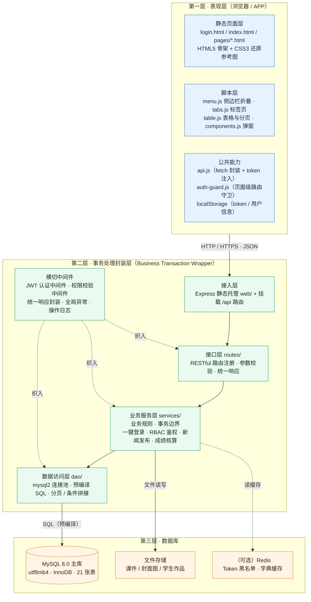
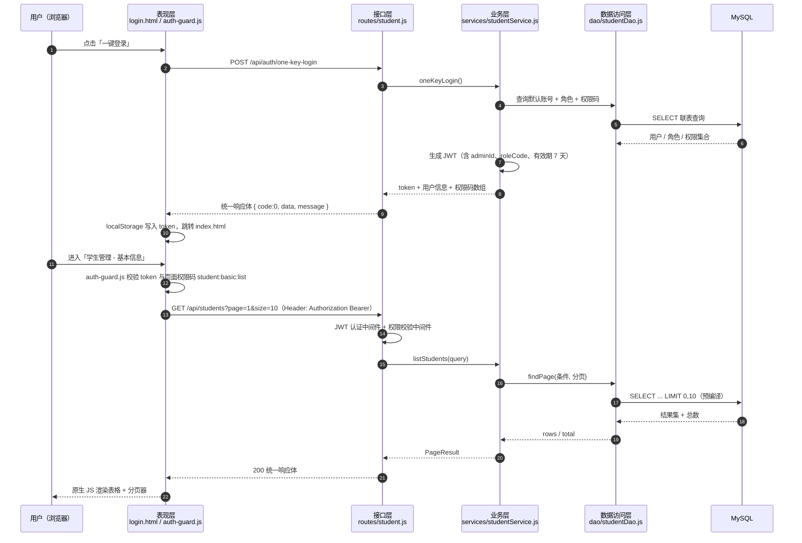

# 第 1 轮交付物 · 功能模块与三层架构

项目：**编程培训平台管理平台**（江京教育）
本轮范围：第一步（整体功能模块图）+ 第二步（三层架构图）
修订记录：第 2 次修订 —— 前端技术栈改为**纯 HTML + CSS + JavaScript**；侧边栏菜单依据参考图重排；移除「奖学金」。

---

## 0. 阶段确认

### 0.1 角色与开发方式

- 定位：资深全栈架构师 + 高级前端工程师，负责本项目的**迭代式**开发。
- 方式：所有代码沉淀在**同一个工程**中，通过 Git 做版本控制；每次迭代只做「增量补充」，不另起项目、不重写已定稿部分。
- 交付顺序严格按：功能模块图 → 三层架构图 → ER 图与表结构 → 前端界面 → 一键登录与路由守卫。

### 0.2 技术栈（第 2 次修订后的统一口径）

| 分层 | 选型 |
| --- | --- |
| 前端 | **原生 HTML5 + CSS3 + JavaScript（ES6+），多页面应用（MPA），零框架、零 UI 库** |
| 前端交互 | 原生 DOM API 手写侧边栏折叠、Tab 切换、表格、分页器、弹窗、表单校验 |
| 前端请求 | 原生 `fetch` 统一封装（`assets/js/api.js`） |
| 前端存储 | `localStorage` 存 token 与用户信息，`sessionStorage` 存页面级筛选条件 |
| 前端路由守卫 | `assets/js/auth-guard.js`，每个页面 `<head>` 内引入，校验 token + 页面权限码 |
| 后端 | Node.js + Express（接口层 / 业务层 / 数据访问层分离） |
| 数据访问 | `mysql2/promise` + 手写 SQL（与 `sql/01-schema.sql` 一一对应） |
| 数据库 | MySQL 8.0（utf8mb4 · InnoDB） |
| 鉴权 | 一键登录 + JWT |

配套目录规划（第 3 轮创建）：

```
programming-training-platform/
├─ web/                       # 前端（纯静态，可由 Express 托管或本地 Live Server 打开）
│  ├─ login.html              # 一键登录页
│  ├─ index.html              # 主框架页（Header + 侧边栏 + 内容容器）
│  ├─ pages/
│  │  ├─ system/user.html     # 用户管理
│  │  ├─ system/role.html     # 角色管理
│  │  ├─ system/permission.html
│  │  ├─ news/index.html      # 新闻中心（Tab 切换）
│  │  ├─ student/basic.html   # 基本信息
│  │  ├─ student/attendance.html
│  │  ├─ student/payment.html
│  │  ├─ student/archive.html
│  │  ├─ student/works.html
│  │  └─ teacher/index.html
│  └─ assets/
│     ├─ css/{base,layout,components,pages}.css
│     ├─ js/{api,auth-guard,menu,components}.js
│     └─ img/
├─ server/                    # 后端
│  ├─ app.js                  # 入口
│  ├─ routes/                 # 接口层
│  ├─ services/               # 业务层（事务边界）
│  └─ dao/                    # 数据访问层
├─ sql/{01-schema.sql,02-seed.sql}
└─ docs/
```

### 0.3 红线约束

| # | 约束 | 落点 |
| --- | --- | --- |
| 1 | 名称只能是「编程培训平台管理平台」 | 页面标题、Logo 文案、包名注释 |
| 2 | 一键登录：无用户名 / 无密码 / 无角色选择 | 登录页（`login.html`） |
| 3 | 新闻中心仅 4 个 Tab：全部 / 平台公告 / 行业资讯 / 赛事动态 | 新闻中心页 |
| 4 | 全站禁止「奖学金」 | 菜单、表结构、接口、文案、种子数据 |
| 5 | 单工程迭代累加 + Git 版本控制 | 仓库根目录 |

### 0.4 参考图 UI 规范速记（用于第 3 轮 1:1 还原）

从两张参考图中提取的关键视觉参数：

| 区域 | 规格 |
| --- | --- |
| 顶部 Header | 青绿色实心条，高 `60px`；左侧白色圆角 Logo 方块（地球图标 + 蓝色「江京教育」文字）+ 汉堡菜单按钮；右侧「进入编程环境」白字 + 小图标 |
| 侧边栏 | 深灰蓝 `#2b2f38`，宽 `260px`，可折叠为 `64px`；整栏独立滚动条 |
| 侧边栏用户区 | 居中：昵称 + 皇冠图标（加粗白字）→「2026-11-12到期 续费>>」（到期时间灰 `#9aa0a6`，续费橙 `#f0a02a`）→「查看会员权益」胶囊按钮（橙黄渐变 `#f7b545 → #f0952c`，深棕字 `#5a3a12`，圆角 `999px`，居中） |
| 菜单项 | 一级项高 `52px`，图标 + 文字 `#d5d8dd`，右侧 ▼/▲ 折叠箭头；二级项高 `48px`、缩进 `padding-left:48px`、无图标、文字 `#c8ccd2` |
| 菜单选中态 | 青绿实心 `#12a08a`，文字白色加粗 |
| 主内容区 | 背景 `#eef0f3`，白卡片圆角 `4px` + 浅阴影 |
| 卡片标题 | 左侧青色竖条（`4px × 20px`，圆角）+ 标题 `18px` 加粗 `#333` |
| Tab 标签页 | 高 `48px`，默认字 `#555`；选中态青色 `#0e9c86` + 底部 `3px` 同色下划线 |
| 列表行 | 左侧标签框（青色 `1px` 描边、浅青底 `#f0faf8`、青字、`4px` 圆角、`13px`）+ 标题 `16px #333`；行分隔线极浅 |
| 分页器 | 居中；当前页为青绿实心方块（`32×32px`，圆角 `4px`），白字 |

### 0.5 参考图菜单与作业要求的差异处理

| 参考图中的菜单 | 处理方式 |
| --- | --- |
| 系统管理 / 新闻中心 / 学生管理 / 课件资源 | ✅ 保留（与作业要求一致） |
| **奖学金** | ❌ **删除**（作业要求明令禁止，界面上绝不出现） |
| 我的题库 / 评测考试 / 师资培训 / 蓝桥优品 / 订单管理 | ❌ **已删除**：改为「学生端 / 教师端」两个自助端（配置见 `web/assets/js/config.js` 的 `JP_SUBSYSTEMS`） |

---

## 第一步：整体功能模块图

```mermaid
flowchart TD
    ROOT["编程培训平台管理平台<br/>（江京教育）"]

    ROOT --> M1["系统管理"]
    ROOT --> M2["新闻中心"]
    ROOT --> M3["教师管理"]
    ROOT --> M4["学生管理"]
    ROOT --> M5["课程管理"]
    ROOT --> M6["班级管理"]
    ROOT --> M7["成绩管理"]
    ROOT --> M8["课件资源"]
    ROOT --> M9["个人中心"]

    M1 --> M1a["用户管理<br/>账号 / 状态 / 归属角色"]
    M1 --> M1b["角色管理<br/>角色定义 / 角色授权"]
    M1 --> M1c["权限管理<br/>菜单权限 / 按钮权限 / 接口权限"]

    M2 --> M2a["全部<br/>（默认 Tab，聚合三类）"]
    M2 --> M2b["平台公告"]
    M2 --> M2c["行业资讯"]
    M2 --> M2d["赛事动态"]

    M3 --> M3a["教师基本信息"]
    M3 --> M3b["授课安排"]
    M3 --> M3c["教学评价"]

    M4 --> M4a["基本信息"]
    M4 --> M4b["学生考勤"]
    M4 --> M4c["缴费管理"]
    M4 --> M4d["学生学习档案"]
    M4 --> M4e["学生作品"]

    M5 --> M5a["课程信息"]
    M5 --> M5b["课程大纲"]
    M5 --> M5c["课程-班级关联"]

    M6 --> M6a["班级信息"]
    M6 --> M6b["班级成员"]
    M6 --> M6c["课表管理"]

    M7 --> M7a["成绩录入"]
    M7 --> M7b["成绩查询 / 导出"]
    M7 --> M7c["成绩统计"]

    M8 --> M8a["课件上传 / 分类"]
    M8 --> M8b["课件下载 / 预览"]

    M9 --> M9a["个人资料"]
    M9 --> M9b["修改密码"]
    M9 --> M9c["会员权益（到期时间 / 续费）"]
    M9 --> M9d["退出登录"]
```



### 1.1 侧边栏菜单树（依据参考图确定，已剔除「奖学金」）

```
江京教育 Logo ── ☰ 折叠按钮 ─────────────────── 进入编程环境
┌──────────────────────────┐
│         覃艳 👑           │  ← 用户区：头像 / 昵称
│   2026-11-12到期 续费>>   │  ← 到期时间 + 续费入口
│     [ 查看会员权益 ]      │  ← 胶囊按钮
├──────────────────────────┤
│ ⚙ 系统管理            ▲  │
│      用户管理             │
│      角色管理             │
│      权限管理             │
│ 🗒 新闻中心（选中态）      │  ← 青绿实心高亮
│ 📁 课件资源            ▼  │
│ ⚙ 教师管理            ▼  │
│      基本信息             │
│      授课安排             │
│      教学评价             │
│ ⚙ 学生管理            ▲  │
│      基本信息             │
│      学生考勤             │
│      缴费管理             │
│      学生学习档案         │
│      学生作品             │
│ ⚙ 课程管理            ▼  │
│ ⚙ 班级管理            ▼  │
│ ⚙ 成绩管理            ▼  │
└──────────────────────────┘
   （原参考图中的「奖学金」一行已删除）
```

### 1.2 权限可见性矩阵（一键登录后按角色渲染菜单）

| 模块 | 超级管理员 | 教务管理员 | 教师 | 学生 |
| --- | --- | --- | --- | --- |
| 系统管理 | ✅ 全部 | ⭕ 仅用户管理（只读） | ❌ | ❌ |
| 新闻中心 | ✅ 增删改查 | ✅ 增删改查 | ⭕ 仅查看 | ⭕ 仅查看 |
| 教师管理 | ✅ | ✅ | ⭕ 仅本人信息 | ❌ |
| 学生管理 | ✅ | ✅ | ⭕ 所带班级 | ⭕ 仅本人 |
| 课程管理 | ✅ | ✅ | ⭕ 所授课程 | ⭕ 仅查看 |
| 班级管理 | ✅ | ✅ | ⭕ 所带班级 | ⭕ 仅本班 |
| 成绩管理 | ✅ | ✅ | ⭕ 所授课程录入 | ⭕ 仅本人成绩 |
| 课件资源 | ✅ | ✅ | ✅ 上传 / 下载 | ⭕ 仅下载 |

图例：✅ 完整权限　⭕ 受限权限　❌ 无权限（菜单不渲染）

---

## 第二步：三层架构图

### 2.1 总体三层架构（前端为纯 HTML/CSS/JS 多页面）



### 2.2 一次请求的调用时序（一键登录 → 加载学生列表）



### 2.3 三层职责边界（便于答辩说明）

| 层 | 职责 | 不该做的事 |
| --- | --- | --- |
| 表现层（浏览器 / APP） | 页面渲染、交互、表单校验、动态菜单、路由守卫、token 携带 | 不写业务规则、不直连数据库、不硬编码权限判断 |
| 事务处理封装层 | 参数校验、鉴权、业务规则、事务边界、缓存读写、统一响应与异常 | 不拼接 SQL 造成注入、不把裸实体直接返回前端 |
| 数据层 | 数据持久化、索引与约束、事务日志、缓存与会话存储 | 不包含业务判断逻辑 |

---

## 下一步（第 2 轮）交付内容

见 [docs/02-数据库设计.md](02-数据库设计.md)：

1. ER 图（Mermaid `erDiagram`）：Admin / Teacher / Student / Course / Class / Schedule / Evaluation / Score / Role / Permission / News 及配套扩展表。
2. 每张表的字段清单（字段名、类型、是否为空、主外键、默认值、注释）。
3. 可直接执行的 MySQL 建表语句（`sql/01-schema.sql`）与初始化种子数据（`sql/02-seed.sql`）。
4. 一致性自检：全库无任何「奖学金」相关表、字段、数据。
