# 第 2 轮交付物 · ER 图与数据表结构

项目：**编程培训平台管理平台**（江京教育）
本轮范围：第三步（ER 图 + 全部实体表结构 + 建表 SQL）
数据库：MySQL 8.0 · 字符集 `utf8mb4` · 排序规则 `utf8mb4_general_ci` · 存储引擎 InnoDB

---

## 0. 设计约定

| 约定 | 说明 |
| --- | --- |
| 表名 | 全小写下划线，业务表用单数（`student`），系统表加 `sys_` 前缀 |
| 主键 | 统一 `id BIGINT UNSIGNED AUTO_INCREMENT` |
| 公共字段 | 每张业务表都带 `create_time`、`update_time`、`deleted`（逻辑删除：0 正常 / 1 已删除） |
| 外键 | 统一命名 `fk_表名_字段名`，关联列必须建索引 |
| 金额 | `DECIMAL(10,2)`，**禁止**用 FLOAT/DOUBLE 存钱 |
| 成绩 | `DECIMAL(5,1)`，满分另用 `full_score` 记录，便于换算百分制 |
| 时间 | `DATE` 存日期、`TIME` 存节次时间、`DATETIME` 存时刻 |
| 状态 | `TINYINT`，取值含义写在字段注释里，前端用字典映射成中文标签 |
| 命名规避 | 「班级」表命名为 `clazz`，避开 `class` 保留字坑 |
| 命名红线 | **全库不允许出现任何与「奖学金」相关的表名、字段名、注释、种子数据** |

---

## 1. ER 图（Mermaid）

```mermaid
erDiagram
    SYS_ADMIN ||--o{ SYS_ADMIN_ROLE : "分配角色"
    SYS_ROLE ||--o{ SYS_ADMIN_ROLE : "被分配"
    SYS_ROLE ||--o{ SYS_ROLE_PERMISSION : "授予权限"
    SYS_PERMISSION ||--o{ SYS_ROLE_PERMISSION : "被授予"
    SYS_PERMISSION ||--o{ SYS_PERMISSION : "父子层级"

    SYS_ADMIN ||--o{ NEWS : "发布"
    SYS_ADMIN ||--o{ COURSEWARE : "上传"
    NEWS_CATEGORY ||--o{ NEWS : "分类"

    COURSE ||--o{ COURSE_CHAPTER : "包含大纲"
    COURSE ||--o{ CLAZZ : "开设班级"
    COURSE ||--o{ COURSEWARE : "配套课件"
    COURSE ||--o{ TEACHER_COURSE : "被安排授课"
    COURSE ||--o{ SCHEDULE : "排入课表"
    COURSE ||--o{ SCORE : "被考核"
    COURSE ||--o{ EVALUATION : "被评价课程"
    COURSE ||--o{ PAYMENT : "缴费对应课程"

    TEACHER ||--o{ CLAZZ : "担任班主任"
    TEACHER ||--o{ TEACHER_COURSE : "授课安排"
    TEACHER ||--o{ SCHEDULE : "上课"
    TEACHER ||--o{ EVALUATION : "被学生评价"
    TEACHER ||--o{ SCORE : "录入成绩"
    TEACHER ||--o{ ATTENDANCE : "记录考勤"

    CLAZZ ||--o{ STUDENT : "包含学生"
    CLAZZ ||--o{ TEACHER_COURSE : "关联班级"
    CLAZZ ||--o{ SCHEDULE : "关联课表"
    CLAZZ ||--o{ ATTENDANCE : "关联考勤"
    CLAZZ ||--o{ SCORE : "关联成绩"

    STUDENT ||--o{ ATTENDANCE : "考勤记录"
    STUDENT ||--o{ PAYMENT : "缴费记录"
    STUDENT ||--o{ STUDY_ARCHIVE : "学习档案"
    STUDENT ||--o{ STUDENT_WORK : "学生作品"
    STUDENT ||--o{ SCORE : "成绩记录"
    STUDENT ||--o{ EVALUATION : "评价教师"

    SYS_ADMIN {
        bigint id PK "主键"
        varchar username UK "登录账号"
        varchar password "密码（bcrypt）"
        varchar real_name "姓名"
        varchar phone "手机号"
        varchar member_level "会员等级"
        date expire_date "会员到期时间"
        tinyint status "1启用0禁用"
        datetime last_login_time "最后登录时间"
        tinyint deleted "逻辑删除"
    }

    SYS_ROLE {
        bigint id PK "主键"
        varchar role_name "角色名称"
        varchar role_code UK "角色编码"
        varchar description "角色描述"
        tinyint status "1启用0禁用"
    }

    SYS_PERMISSION {
        bigint id PK "主键"
        bigint parent_id "父级权限ID，0为顶级"
        varchar permission_name "权限名称"
        varchar permission_code UK "权限编码"
        tinyint type "1目录2菜单3按钮"
        varchar path "前端页面路径"
        varchar icon "菜单图标"
    }

    SYS_ADMIN_ROLE {
        bigint id PK "主键"
        bigint admin_id FK "管理员ID"
        bigint role_id FK "角色ID"
    }

    SYS_ROLE_PERMISSION {
        bigint id PK "主键"
        bigint role_id FK "角色ID"
        bigint permission_id FK "权限ID"
    }

    TEACHER {
        bigint id PK "主键"
        varchar teacher_no UK "教师工号"
        varchar name "姓名"
        tinyint gender "1男2女"
        varchar title "职称"
        varchar major_direction "擅长方向"
        date entry_date "入职日期"
        tinyint status "1在职0离职"
    }

    STUDENT {
        bigint id PK "主键"
        varchar student_no UK "学号"
        varchar name "姓名"
        tinyint gender "1男2女"
        date birth_date "出生日期"
        bigint class_id FK "所属班级ID"
        varchar guardian_phone "监护人电话"
        date enroll_date "报名日期"
        tinyint status "1在读2结业3休学4退学"
    }

    CLAZZ {
        bigint id PK "主键"
        varchar class_code UK "班级编号"
        varchar class_name "班级名称"
        bigint course_id FK "所属课程ID"
        bigint head_teacher_id FK "班主任ID"
        varchar classroom "教室"
        date start_date "开班日期"
        date end_date "结课日期"
        int capacity "计划人数"
        int student_count "在读人数"
        tinyint status "0未开班1在读2已结业"
    }

    COURSE {
        bigint id PK "主键"
        varchar course_code UK "课程编号"
        varchar course_name "课程名称"
        varchar category "课程分类"
        decimal credit "学分"
        int total_hours "总课时"
        decimal price "课程价格"
        tinyint status "1上架0下架"
    }

    COURSE_CHAPTER {
        bigint id PK "主键"
        bigint course_id FK "课程ID"
        bigint parent_id "父章节ID，0为章"
        varchar chapter_name "章节名称"
        int hours "课时数"
        int sort_order "排序"
    }

    TEACHER_COURSE {
        bigint id PK "主键"
        bigint teacher_id FK "教师ID"
        bigint course_id FK "课程ID"
        bigint class_id FK "班级ID"
        varchar term "学期"
        int total_hours "承担课时"
        tinyint role_type "1主讲2辅导3班主任"
    }

    SCHEDULE {
        bigint id PK "主键"
        bigint class_id FK "班级ID"
        bigint course_id FK "课程ID"
        bigint teacher_id FK "授课教师ID"
        varchar classroom "教室"
        tinyint weekday "星期1-7"
        time lesson_start "上课时间"
        time lesson_end "下课时间"
        varchar term "学期"
        date start_date "生效日期"
        date end_date "失效日期"
    }

    EVALUATION {
        bigint id PK "主键"
        tinyint eval_type "1学生评教2督导评教"
        bigint teacher_id FK "被评教师ID"
        bigint student_id FK "评价学生ID"
        bigint course_id FK "课程ID"
        bigint class_id FK "班级ID"
        decimal score "评分（满分10）"
        text content "评价内容"
        date eval_date "评价日期"
    }

    SCORE {
        bigint id PK "主键"
        bigint student_id FK "学生ID"
        bigint course_id FK "课程ID"
        bigint class_id FK "班级ID"
        tinyint exam_type "1阶段测验2期中3期末4作品5综合"
        decimal score "得分"
        decimal full_score "满分"
        bigint teacher_id FK "录入教师ID"
        date exam_date "考核日期"
    }

    ATTENDANCE {
        bigint id PK "主键"
        bigint student_id FK "学生ID"
        bigint class_id FK "班级ID"
        bigint course_id FK "课程ID"
        date attend_date "考勤日期"
        tinyint attend_type "1正常2迟到3早退4请假5缺勤"
        time check_time "打卡时间"
        varchar remark "备注"
    }

    PAYMENT {
        bigint id PK "主键"
        bigint student_id FK "学生ID"
        varchar order_no UK "缴费单号"
        bigint course_id FK "课程ID"
        bigint class_id FK "班级ID"
        tinyint pay_type "1新报2续费3补费4退费"
        decimal should_amount "应收金额"
        decimal paid_amount "实收金额"
        decimal arrears_amount "欠费金额"
        tinyint pay_status "0未缴1部分缴2已缴清3已退费"
        tinyint pay_method "1微信2支付宝3现金4银行转账"
        datetime pay_time "缴费时间"
    }

    STUDY_ARCHIVE {
        bigint id PK "主键"
        bigint student_id FK "学生ID"
        bigint class_id FK "班级ID"
        bigint course_id FK "课程ID"
        int stage_no "阶段序号"
        varchar stage_name "阶段名称"
        decimal study_hours "累计课时"
        decimal assess_score "阶段测评得分"
        varchar ability_tags "能力标签"
        varchar teacher_comment "教师评语"
        date archive_date "归档日期"
    }

    STUDENT_WORK {
        bigint id PK "主键"
        bigint student_id FK "学生ID"
        bigint class_id FK "班级ID"
        bigint course_id FK "课程ID"
        varchar title "作品名称"
        tinyint work_type "1代码项目2设计稿3文档4视频"
        varchar file_url "作品文件地址"
        varchar teacher_comment "教师点评"
        decimal score "作品评分"
        tinyint is_public "1公开展示0仅内部"
        datetime submit_time "提交时间"
    }

    COURSEWARE {
        bigint id PK "主键"
        bigint course_id FK "课程ID"
        varchar category "课件分类"
        varchar title "课件名称"
        varchar file_url "文件地址"
        varchar file_type "文件类型"
        bigint file_size "文件大小（字节）"
        bigint upload_admin_id FK "上传人ID"
        int download_count "下载次数"
        tinyint status "1可用0停用"
    }

    NEWS_CATEGORY {
        bigint id PK "主键"
        varchar category_code UK "分类编码"
        varchar category_name "分类名称"
        int sort_order "排序"
        tinyint status "1启用0停用"
    }

    NEWS {
        bigint id PK "主键"
        varchar title "新闻标题"
        bigint category_id FK "分类ID"
        varchar summary "摘要"
        longtext content "正文"
        varchar author "作者"
        varchar source "来源"
        tinyint is_top "1置顶0普通"
        int view_count "浏览量"
        tinyint status "0草稿1已发布2已下线"
        datetime publish_time "发布时间"
        bigint publisher_id FK "发布人ID"
    }
```



---

## 2. 表清单总览（21 张）

| # | 表名 | 中文名 | 所属模块 | 说明 |
| --- | --- | --- | --- | --- |
| 1 | `sys_admin` | 管理员表 | 系统管理 | 含超级管理员、教务、教师登录账号 |
| 2 | `sys_role` | 角色表 | 系统管理 | 超管 / 教务 / 教师 / 学生 |
| 3 | `sys_permission` | 权限表 | 系统管理 | 目录 / 菜单 / 按钮三级权限，树形自关联 |
| 4 | `sys_admin_role` | 管理员-角色关联表 | 系统管理 | 多对多 |
| 5 | `sys_role_permission` | 角色-权限关联表 | 系统管理 | 多对多 |
| 6 | `teacher` | 教师表 | 教师管理 | 基本信息 + 授课 + 评价的被评对象 |
| 7 | `student` | 学生表 | 学生管理 | 基本信息 |
| 8 | `clazz` | 班级表 | 班级管理 | 避开保留字，命名 `clazz` |
| 9 | `course` | 课程表 | 课程管理 | 课程信息 |
| 10 | `course_chapter` | 课程大纲表 | 课程管理 | 章 / 节树形结构 |
| 11 | `teacher_course` | 教师授课安排表 | 教师管理 | 教师 ↔ 课程 ↔ 班级 |
| 12 | `schedule` | 课表 | 班级管理 | 周课表 |
| 13 | `evaluation` | 评价表 | 教师管理 | 学生评教 / 督导评教 |
| 14 | `score` | 成绩表 | 成绩管理 | 多考试类型 |
| 15 | `attendance` | 学生考勤表 | 学生管理 | 出勤 / 迟到 / 请假 / 缺勤 |
| 16 | `payment` | 缴费管理表 | 学生管理 | 应收 / 实收 / 欠费 |
| 17 | `study_archive` | 学生学习档案表 | 学生管理 | 阶段学习轨迹与评语 |
| 18 | `student_work` | 学生作品表 | 学生管理 | 作品提交与点评 |
| 19 | `courseware` | 课件资源表 | 课件资源 | 课件上传与下载 |
| 20 | `news_category` | 新闻分类表 | 新闻中心 | 平台公告 / 行业资讯 / 赛事动态 |
| 21 | `news` | 新闻表 | 新闻中心 | 三类动态统一存储 |

---

## 3. 详细表结构

### 3.1 `sys_admin` 管理员表

| 字段名 | 类型 | 允许空 | 键/约束 | 默认值 | 注释 |
| --- | --- | --- | --- | --- | --- |
| id | BIGINT UNSIGNED | 否 | PK, AUTO_INCREMENT | — | 主键 |
| username | VARCHAR(50) | 否 | UNIQUE | — | 登录账号 |
| password | VARCHAR(100) | 否 | | — | 密码（bcrypt 加密；一键登录不校验，保留用于扩展） |
| real_name | VARCHAR(50) | 否 | | — | 姓名 |
| avatar | VARCHAR(255) | 是 | | NULL | 头像地址 |
| phone | VARCHAR(20) | 是 | | NULL | 手机号 |
| email | VARCHAR(100) | 是 | | NULL | 邮箱 |
| gender | TINYINT | 是 | | 0 | 性别：1 男 / 2 女 / 0 未知 |
| member_level | VARCHAR(20) | 是 | | NULL | 会员等级（侧边栏昵称旁皇冠标识） |
| expire_date | DATE | 是 | IDX | NULL | 会员到期时间（侧边栏展示「xxxx-xx-xx 到期」） |
| status | TINYINT | 否 | IDX | 1 | 状态：1 启用 / 0 禁用 |
| last_login_time | DATETIME | 是 | | NULL | 最后登录时间 |
| last_login_ip | VARCHAR(50) | 是 | | NULL | 最后登录 IP |
| remark | VARCHAR(255) | 是 | | NULL | 备注 |
| create_time | DATETIME | 否 | | CURRENT_TIMESTAMP | 创建时间 |
| update_time | DATETIME | 否 | | CURRENT_TIMESTAMP（更新自动刷新） | 更新时间 |
| deleted | TINYINT | 否 | IDX | 0 | 逻辑删除：0 正常 / 1 已删除 |

### 3.2 `sys_role` 角色表

| 字段名 | 类型 | 允许空 | 键/约束 | 默认值 | 注释 |
| --- | --- | --- | --- | --- | --- |
| id | BIGINT UNSIGNED | 否 | PK, AUTO_INCREMENT | — | 主键 |
| role_name | VARCHAR(50) | 否 | | — | 角色名称 |
| role_code | VARCHAR(50) | 否 | UNIQUE | — | 角色编码：SUPER_ADMIN / EDU_ADMIN / TEACHER / STUDENT |
| description | VARCHAR(255) | 是 | | NULL | 角色描述 |
| sort_order | INT | 否 | | 0 | 显示排序 |
| status | TINYINT | 否 | | 1 | 状态：1 启用 / 0 停用 |
| create_time | DATETIME | 否 | | CURRENT_TIMESTAMP | 创建时间 |
| update_time | DATETIME | 否 | | CURRENT_TIMESTAMP（更新自动刷新） | 更新时间 |

### 3.3 `sys_permission` 权限表

| 字段名 | 类型 | 允许空 | 键/约束 | 默认值 | 注释 |
| --- | --- | --- | --- | --- | --- |
| id | BIGINT UNSIGNED | 否 | PK, AUTO_INCREMENT | — | 主键 |
| parent_id | BIGINT UNSIGNED | 否 | IDX | 0 | 父级权限 ID（0 表示顶级；自关联树不建外键约束） |
| permission_name | VARCHAR(50) | 否 | | — | 权限名称（菜单名 / 按钮名） |
| permission_code | VARCHAR(100) | 否 | UNIQUE | — | 权限编码，如 `system:user:list` |
| type | TINYINT | 否 | | 2 | 类型：1 目录 / 2 菜单 / 3 按钮 |
| path | VARCHAR(200) | 是 | | NULL | 前端页面路径，如 `pages/system/user.html` |
| component | VARCHAR(200) | 是 | | NULL | 页面组件标识（预留） |
| icon | VARCHAR(50) | 是 | | NULL | 菜单图标标识 |
| sort_order | INT | 否 | | 0 | 显示排序 |
| status | TINYINT | 否 | | 1 | 状态：1 启用 / 0 停用 |
| create_time | DATETIME | 否 | | CURRENT_TIMESTAMP | 创建时间 |
| update_time | DATETIME | 否 | | CURRENT_TIMESTAMP（更新自动刷新） | 更新时间 |

### 3.4 `sys_admin_role` 管理员-角色关联表

| 字段名 | 类型 | 允许空 | 键/约束 | 默认值 | 注释 |
| --- | --- | --- | --- | --- | --- |
| id | BIGINT UNSIGNED | 否 | PK, AUTO_INCREMENT | — | 主键 |
| admin_id | BIGINT UNSIGNED | 否 | FK → sys_admin.id, 联合唯一 | — | 管理员 ID |
| role_id | BIGINT UNSIGNED | 否 | FK → sys_role.id, 联合唯一 | — | 角色 ID |
| create_time | DATETIME | 否 | | CURRENT_TIMESTAMP | 创建时间 |

> 联合唯一键 `uk_admin_role(admin_id, role_id)`：同一管理员不能重复分配同一角色。

### 3.5 `sys_role_permission` 角色-权限关联表

| 字段名 | 类型 | 允许空 | 键/约束 | 默认值 | 注释 |
| --- | --- | --- | --- | --- | --- |
| id | BIGINT UNSIGNED | 否 | PK, AUTO_INCREMENT | — | 主键 |
| role_id | BIGINT UNSIGNED | 否 | FK → sys_role.id, 联合唯一 | — | 角色 ID |
| permission_id | BIGINT UNSIGNED | 否 | FK → sys_permission.id, 联合唯一 | — | 权限 ID |
| create_time | DATETIME | 否 | | CURRENT_TIMESTAMP | 创建时间 |

> 联合唯一键 `uk_role_permission(role_id, permission_id)`。

### 3.6 `teacher` 教师表

| 字段名 | 类型 | 允许空 | 键/约束 | 默认值 | 注释 |
| --- | --- | --- | --- | --- | --- |
| id | BIGINT UNSIGNED | 否 | PK, AUTO_INCREMENT | — | 主键 |
| teacher_no | VARCHAR(30) | 否 | UNIQUE | — | 教师工号 |
| name | VARCHAR(50) | 否 | IDX | — | 姓名 |
| gender | TINYINT | 否 | | 1 | 性别：1 男 / 2 女 |
| phone | VARCHAR(20) | 是 | | NULL | 联系电话 |
| email | VARCHAR(100) | 是 | | NULL | 邮箱 |
| avatar | VARCHAR(255) | 是 | | NULL | 头像 |
| title | VARCHAR(30) | 是 | | NULL | 职称，如「高级讲师」 |
| major_direction | VARCHAR(100) | 是 | | NULL | 擅长方向，如「Python / 算法竞赛」 |
| education | VARCHAR(30) | 是 | | NULL | 学历 |
| entry_date | DATE | 是 | | NULL | 入职日期 |
| status | TINYINT | 否 | IDX | 1 | 状态：1 在职 / 0 离职 |
| intro | TEXT | 是 | | NULL | 教师简介 |
| create_time | DATETIME | 否 | | CURRENT_TIMESTAMP | 创建时间 |
| update_time | DATETIME | 否 | | CURRENT_TIMESTAMP（更新自动刷新） | 更新时间 |
| deleted | TINYINT | 否 | | 0 | 逻辑删除：0 正常 / 1 已删除 |

### 3.7 `student` 学生表

| 字段名 | 类型 | 允许空 | 键/约束 | 默认值 | 注释 |
| --- | --- | --- | --- | --- | --- |
| id | BIGINT UNSIGNED | 否 | PK, AUTO_INCREMENT | — | 主键 |
| student_no | VARCHAR(30) | 否 | UNIQUE | — | 学号 |
| name | VARCHAR(50) | 否 | IDX | — | 姓名 |
| gender | TINYINT | 否 | | 1 | 性别：1 男 / 2 女 |
| birth_date | DATE | 是 | | NULL | 出生日期 |
| id_card | VARCHAR(18) | 是 | | NULL | 身份证号 |
| phone | VARCHAR(20) | 是 | | NULL | 联系电话 |
| email | VARCHAR(100) | 是 | | NULL | 邮箱 |
| avatar | VARCHAR(255) | 是 | | NULL | 头像 |
| class_id | BIGINT UNSIGNED | 是 | FK → clazz.id, IDX | NULL | 所属班级 ID（未分班为空） |
| guardian_name | VARCHAR(50) | 是 | | NULL | 监护人姓名 |
| guardian_phone | VARCHAR(20) | 是 | | NULL | 监护人电话 |
| address | VARCHAR(255) | 是 | | NULL | 家庭住址 |
| enroll_date | DATE | 是 | | NULL | 报名日期 |
| source | VARCHAR(50) | 是 | | NULL | 报名来源，如「线上推广」 |
| status | TINYINT | 否 | IDX | 1 | 状态：1 在读 / 2 已结业 / 3 休学 / 4 退学 |
| create_time | DATETIME | 否 | | CURRENT_TIMESTAMP | 创建时间 |
| update_time | DATETIME | 否 | | CURRENT_TIMESTAMP（更新自动刷新） | 更新时间 |
| deleted | TINYINT | 否 | | 0 | 逻辑删除：0 正常 / 1 已删除 |

### 3.8 `clazz` 班级表

| 字段名 | 类型 | 允许空 | 键/约束 | 默认值 | 注释 |
| --- | --- | --- | --- | --- | --- |
| id | BIGINT UNSIGNED | 否 | PK, AUTO_INCREMENT | — | 主键 |
| class_code | VARCHAR(30) | 否 | UNIQUE | — | 班级编号 |
| class_name | VARCHAR(100) | 否 | IDX | — | 班级名称，如「Python 全栈 2603 班」 |
| course_id | BIGINT UNSIGNED | 否 | FK → course.id, IDX | — | 所属课程 ID |
| head_teacher_id | BIGINT UNSIGNED | 是 | FK → teacher.id, IDX | NULL | 班主任 ID |
| classroom | VARCHAR(50) | 是 | | NULL | 教室 |
| start_date | DATE | 是 | | NULL | 开班日期 |
| end_date | DATE | 是 | | NULL | 结课日期 |
| capacity | INT | 否 | | 30 | 计划招生人数 |
| student_count | INT | 否 | | 0 | 在读人数（由学生表统计维护） |
| status | TINYINT | 否 | IDX | 0 | 状态：0 未开班 / 1 在读 / 2 已结业 |
| remark | VARCHAR(255) | 是 | | NULL | 备注 |
| create_time | DATETIME | 否 | | CURRENT_TIMESTAMP | 创建时间 |
| update_time | DATETIME | 否 | | CURRENT_TIMESTAMP（更新自动刷新） | 更新时间 |
| deleted | TINYINT | 否 | | 0 | 逻辑删除：0 正常 / 1 已删除 |

### 3.9 `course` 课程表

| 字段名 | 类型 | 允许空 | 键/约束 | 默认值 | 注释 |
| --- | --- | --- | --- | --- | --- |
| id | BIGINT UNSIGNED | 否 | PK, AUTO_INCREMENT | — | 主键 |
| course_code | VARCHAR(30) | 否 | UNIQUE | — | 课程编号 |
| course_name | VARCHAR(100) | 否 | IDX | — | 课程名称 |
| category | VARCHAR(50) | 是 | IDX | NULL | 课程分类，如「Python」「算法竞赛」 |
| credit | DECIMAL(3,1) | 否 | | 0.0 | 学分 |
| total_hours | INT | 否 | | 0 | 总课时 |
| price | DECIMAL(10,2) | 否 | | 0.00 | 课程价格（元） |
| cover_img | VARCHAR(255) | 是 | | NULL | 封面图地址 |
| description | TEXT | 是 | | NULL | 课程简介 |
| status | TINYINT | 否 | IDX | 1 | 状态：1 上架 / 0 下架 |
| create_time | DATETIME | 否 | | CURRENT_TIMESTAMP | 创建时间 |
| update_time | DATETIME | 否 | | CURRENT_TIMESTAMP（更新自动刷新） | 更新时间 |
| deleted | TINYINT | 否 | | 0 | 逻辑删除：0 正常 / 1 已删除 |

### 3.10 `course_chapter` 课程大纲表

| 字段名 | 类型 | 允许空 | 键/约束 | 默认值 | 注释 |
| --- | --- | --- | --- | --- | --- |
| id | BIGINT UNSIGNED | 否 | PK, AUTO_INCREMENT | — | 主键 |
| course_id | BIGINT UNSIGNED | 否 | FK → course.id, IDX | — | 课程 ID |
| parent_id | BIGINT UNSIGNED | 否 | IDX | 0 | 父章节 ID（0 表示章；自关联树不建外键约束） |
| chapter_name | VARCHAR(100) | 否 | | — | 章节名称 |
| hours | INT | 否 | | 0 | 课时数 |
| sort_order | INT | 否 | | 0 | 排序 |
| content | TEXT | 是 | | NULL | 知识点说明 |
| create_time | DATETIME | 否 | | CURRENT_TIMESTAMP | 创建时间 |
| update_time | DATETIME | 否 | | CURRENT_TIMESTAMP（更新自动刷新） | 更新时间 |

### 3.11 `teacher_course` 教师授课安排表

| 字段名 | 类型 | 允许空 | 键/约束 | 默认值 | 注释 |
| --- | --- | --- | --- | --- | --- |
| id | BIGINT UNSIGNED | 否 | PK, AUTO_INCREMENT | — | 主键 |
| teacher_id | BIGINT UNSIGNED | 否 | FK → teacher.id, IDX | — | 教师 ID |
| course_id | BIGINT UNSIGNED | 否 | FK → course.id, IDX | — | 课程 ID |
| class_id | BIGINT UNSIGNED | 是 | FK → clazz.id, IDX | NULL | 班级 ID |
| term | VARCHAR(20) | 是 | | NULL | 学期，如「2026 春」 |
| total_hours | INT | 否 | | 0 | 承担课时 |
| role_type | TINYINT | 否 | | 1 | 角色：1 主讲 / 2 辅导 / 3 班主任 |
| create_time | DATETIME | 否 | | CURRENT_TIMESTAMP | 创建时间 |
| update_time | DATETIME | 否 | | CURRENT_TIMESTAMP（更新自动刷新） | 更新时间 |

### 3.12 `schedule` 课表

| 字段名 | 类型 | 允许空 | 键/约束 | 默认值 | 注释 |
| --- | --- | --- | --- | --- | --- |
| id | BIGINT UNSIGNED | 否 | PK, AUTO_INCREMENT | — | 主键 |
| class_id | BIGINT UNSIGNED | 否 | FK → clazz.id, IDX | — | 班级 ID |
| course_id | BIGINT UNSIGNED | 否 | FK → course.id, IDX | — | 课程 ID |
| teacher_id | BIGINT UNSIGNED | 否 | FK → teacher.id, IDX | — | 授课教师 ID |
| classroom | VARCHAR(50) | 是 | | NULL | 教室 |
| weekday | TINYINT | 否 | IDX | 1 | 星期：1~7 |
| lesson_start | TIME | 否 | | — | 上课时间 |
| lesson_end | TIME | 否 | | — | 下课时间 |
| term | VARCHAR(20) | 是 | | NULL | 学期，如「2026春」 |
| start_date | DATE | 是 | | NULL | 生效日期 |
| end_date | DATE | 是 | | NULL | 失效日期 |
| remark | VARCHAR(255) | 是 | | NULL | 备注 |
| create_time | DATETIME | 否 | | CURRENT_TIMESTAMP | 创建时间 |
| update_time | DATETIME | 否 | | CURRENT_TIMESTAMP（更新自动刷新） | 更新时间 |
| deleted | TINYINT | 否 | | 0 | 逻辑删除：0 正常 / 1 已删除 |

### 3.13 `evaluation` 评价表

| 字段名 | 类型 | 允许空 | 键/约束 | 默认值 | 注释 |
| --- | --- | --- | --- | --- | --- |
| id | BIGINT UNSIGNED | 否 | PK, AUTO_INCREMENT | — | 主键 |
| eval_type | TINYINT | 否 | IDX | 1 | 类型：1 学生评教 / 2 督导评教 |
| teacher_id | BIGINT UNSIGNED | 否 | FK → teacher.id, IDX | — | 被评教师 ID |
| student_id | BIGINT UNSIGNED | 是 | FK → student.id, IDX | NULL | 评价学生 ID（督导评教为空） |
| course_id | BIGINT UNSIGNED | 是 | FK → course.id, IDX | NULL | 课程 ID |
| class_id | BIGINT UNSIGNED | 是 | FK → clazz.id, IDX | NULL | 班级 ID |
| score | DECIMAL(3,1) | 否 | | 0.0 | 评分（满分 10 分） |
| content | TEXT | 是 | | NULL | 评价内容 |
| eval_date | DATE | 否 | IDX | NULL | 评价日期 |
| create_time | DATETIME | 否 | | CURRENT_TIMESTAMP | 创建时间 |
| update_time | DATETIME | 否 | | CURRENT_TIMESTAMP（更新自动刷新） | 更新时间 |

### 3.14 `score` 成绩表

| 字段名 | 类型 | 允许空 | 键/约束 | 默认值 | 注释 |
| --- | --- | --- | --- | --- | --- |
| id | BIGINT UNSIGNED | 否 | PK, AUTO_INCREMENT | — | 主键 |
| student_id | BIGINT UNSIGNED | 否 | FK → student.id, 联合唯一, IDX | — | 学生 ID |
| course_id | BIGINT UNSIGNED | 否 | FK → course.id, 联合唯一, IDX | — | 课程 ID |
| class_id | BIGINT UNSIGNED | 是 | FK → clazz.id, IDX | NULL | 班级 ID |
| exam_type | TINYINT | 否 | 联合唯一, IDX | 1 | 类型：1 阶段测验 / 2 期中 / 3 期末 / 4 作品评分 / 5 综合 |
| score | DECIMAL(5,1) | 否 | | 0.0 | 得分 |
| full_score | DECIMAL(5,1) | 否 | | 100.0 | 满分（用于换算百分制） |
| exam_date | DATE | 是 | | NULL | 考核日期 |
| teacher_id | BIGINT UNSIGNED | 是 | FK → teacher.id | NULL | 录入教师 ID |
| remark | VARCHAR(255) | 是 | | NULL | 备注 |
| create_time | DATETIME | 否 | | CURRENT_TIMESTAMP | 创建时间 |
| update_time | DATETIME | 否 | | CURRENT_TIMESTAMP（更新自动刷新） | 更新时间 |
| deleted | TINYINT | 否 | | 0 | 逻辑删除：0 正常 / 1 已删除 |

> 联合唯一键 `uk_score(student_id, course_id, exam_type)`：同一学生同一课程的同类考试只保留一条成绩，重复录入走 UPDATE。

### 3.15 `attendance` 学生考勤表

| 字段名 | 类型 | 允许空 | 键/约束 | 默认值 | 注释 |
| --- | --- | --- | --- | --- | --- |
| id | BIGINT UNSIGNED | 否 | PK, AUTO_INCREMENT | — | 主键 |
| student_id | BIGINT UNSIGNED | 否 | FK → student.id, 联合唯一, IDX | — | 学生 ID |
| class_id | BIGINT UNSIGNED | 是 | FK → clazz.id, IDX | NULL | 班级 ID |
| course_id | BIGINT UNSIGNED | 否 | FK → course.id, 联合唯一 | — | 课程 ID |
| teacher_id | BIGINT UNSIGNED | 是 | FK → teacher.id | NULL | 记录教师 ID |
| attend_date | DATE | 否 | 联合唯一, IDX | — | 考勤日期 |
| attend_type | TINYINT | 否 | IDX | 1 | 类型：1 正常 / 2 迟到 / 3 早退 / 4 请假 / 5 缺勤 |
| check_time | TIME | 是 | | NULL | 打卡时间 |
| remark | VARCHAR(255) | 是 | | NULL | 备注（请假原因等） |
| create_time | DATETIME | 否 | | CURRENT_TIMESTAMP | 创建时间 |
| update_time | DATETIME | 否 | | CURRENT_TIMESTAMP（更新自动刷新） | 更新时间 |

> 联合唯一键 `uk_attendance(student_id, course_id, attend_date)`：一个学生一门课一天只记一条考勤。

### 3.16 `payment` 缴费管理表

| 字段名 | 类型 | 允许空 | 键/约束 | 默认值 | 注释 |
| --- | --- | --- | --- | --- | --- |
| id | BIGINT UNSIGNED | 否 | PK, AUTO_INCREMENT | — | 主键 |
| student_id | BIGINT UNSIGNED | 否 | FK → student.id, IDX | — | 学生 ID |
| order_no | VARCHAR(40) | 否 | UNIQUE | — | 缴费单号 |
| course_id | BIGINT UNSIGNED | 是 | FK → course.id, IDX | NULL | 课程 ID |
| class_id | BIGINT UNSIGNED | 是 | FK → clazz.id, IDX | NULL | 班级 ID |
| pay_type | TINYINT | 否 | | 1 | 类型：1 新报名 / 2 续费 / 3 补费 / 4 退费 |
| should_amount | DECIMAL(10,2) | 否 | | 0.00 | 应收金额 |
| discount_amount | DECIMAL(10,2) | 否 | | 0.00 | 优惠金额 |
| paid_amount | DECIMAL(10,2) | 否 | | 0.00 | 实收金额 |
| arrears_amount | DECIMAL(10,2) | 否 | | 0.00 | 欠费金额 = 应收 − 优惠 − 实收 |
| pay_status | TINYINT | 否 | IDX | 0 | 状态：0 未缴 / 1 部分缴纳 / 2 已缴清 / 3 已退费 |
| pay_method | TINYINT | 是 | | NULL | 方式：1 微信 / 2 支付宝 / 3 现金 / 4 银行转账 |
| pay_time | DATETIME | 是 | | NULL | 缴费时间 |
| operator_id | BIGINT UNSIGNED | 是 | FK → sys_admin.id | NULL | 经办人 ID |
| remark | VARCHAR(255) | 是 | | NULL | 备注 |
| create_time | DATETIME | 否 | | CURRENT_TIMESTAMP | 创建时间 |
| update_time | DATETIME | 否 | | CURRENT_TIMESTAMP（更新自动刷新） | 更新时间 |
| deleted | TINYINT | 否 | | 0 | 逻辑删除：0 正常 / 1 已删除 |

### 3.17 `study_archive` 学生学习档案表

| 字段名 | 类型 | 允许空 | 键/约束 | 默认值 | 注释 |
| --- | --- | --- | --- | --- | --- |
| id | BIGINT UNSIGNED | 否 | PK, AUTO_INCREMENT | — | 主键 |
| student_id | BIGINT UNSIGNED | 否 | FK → student.id, 联合唯一, IDX | — | 学生 ID |
| class_id | BIGINT UNSIGNED | 是 | FK → clazz.id, IDX | NULL | 班级 ID |
| course_id | BIGINT UNSIGNED | 否 | FK → course.id, 联合唯一 | — | 课程 ID |
| stage_no | INT | 否 | 联合唯一 | 1 | 阶段序号：1、2、3…… |
| stage_name | VARCHAR(50) | 否 | | — | 阶段名称，如「Python 基础」「算法进阶」 |
| study_hours | DECIMAL(6,1) | 否 | | 0.0 | 该阶段累计课时 |
| assess_score | DECIMAL(5,1) | 是 | | NULL | 阶段测评得分 |
| ability_tags | VARCHAR(255) | 是 | | NULL | 能力标签，如「循环/函数/调试能力」 |
| teacher_comment | VARCHAR(500) | 是 | | NULL | 教师阶段评语 |
| archive_date | DATE | 是 | | NULL | 归档日期 |
| create_time | DATETIME | 否 | | CURRENT_TIMESTAMP | 创建时间 |
| update_time | DATETIME | 否 | | CURRENT_TIMESTAMP（更新自动刷新） | 更新时间 |
| deleted | TINYINT | 否 | | 0 | 逻辑删除：0 正常 / 1 已删除 |

> 联合唯一键 `uk_archive(student_id, course_id, stage_no)`：一个学生一门课的一个阶段只有一条档案。

### 3.18 `student_work` 学生作品表

| 字段名 | 类型 | 允许空 | 键/约束 | 默认值 | 注释 |
| --- | --- | --- | --- | --- | --- |
| id | BIGINT UNSIGNED | 否 | PK, AUTO_INCREMENT | — | 主键 |
| student_id | BIGINT UNSIGNED | 否 | FK → student.id, IDX | — | 学生 ID |
| class_id | BIGINT UNSIGNED | 是 | FK → clazz.id, IDX | NULL | 班级 ID |
| course_id | BIGINT UNSIGNED | 是 | FK → course.id, IDX | NULL | 课程 ID |
| title | VARCHAR(100) | 否 | | — | 作品名称 |
| work_type | TINYINT | 否 | IDX | 1 | 类型：1 代码项目 / 2 设计稿 / 3 文档 / 4 视频 |
| cover_img | VARCHAR(255) | 是 | | NULL | 封面图 |
| file_url | VARCHAR(255) | 是 | | NULL | 作品文件 / 仓库地址 |
| description | TEXT | 是 | | NULL | 作品说明 |
| teacher_comment | VARCHAR(500) | 是 | | NULL | 教师点评 |
| score | DECIMAL(5,1) | 是 | | NULL | 作品评分 |
| is_public | TINYINT | 否 | | 1 | 是否公开展示：1 公开 / 0 仅内部 |
| submit_time | DATETIME | 是 | | NULL | 提交时间 |
| create_time | DATETIME | 否 | | CURRENT_TIMESTAMP | 创建时间 |
| update_time | DATETIME | 否 | | CURRENT_TIMESTAMP（更新自动刷新） | 更新时间 |
| deleted | TINYINT | 否 | | 0 | 逻辑删除：0 正常 / 1 已删除 |

### 3.19 `courseware` 课件资源表

| 字段名 | 类型 | 允许空 | 键/约束 | 默认值 | 注释 |
| --- | --- | --- | --- | --- | --- |
| id | BIGINT UNSIGNED | 否 | PK, AUTO_INCREMENT | — | 主键 |
| course_id | BIGINT UNSIGNED | 是 | FK → course.id, IDX | NULL | 关联课程 ID |
| category | VARCHAR(50) | 是 | IDX | NULL | 课件分类：课件讲义 / 练习题库 / 源码素材 / 复习资料 / 课堂录屏 |
| title | VARCHAR(100) | 否 | IDX | — | 课件名称 |
| file_url | VARCHAR(255) | 否 | | — | 文件地址 |
| file_type | VARCHAR(20) | 是 | | NULL | 文件类型：pdf / pptx / zip / mp4 |
| file_size | BIGINT | 否 | | 0 | 文件大小（字节） |
| upload_admin_id | BIGINT UNSIGNED | 是 | FK → sys_admin.id | NULL | 上传人 ID |
| download_count | INT | 否 | | 0 | 下载次数 |
| status | TINYINT | 否 | | 1 | 状态：1 可用 / 0 停用 |
| create_time | DATETIME | 否 | | CURRENT_TIMESTAMP | 创建时间 |
| update_time | DATETIME | 否 | | CURRENT_TIMESTAMP（更新自动刷新） | 更新时间 |
| deleted | TINYINT | 否 | | 0 | 逻辑删除：0 正常 / 1 已删除 |

### 3.20 `news_category` 新闻分类表

| 字段名 | 类型 | 允许空 | 键/约束 | 默认值 | 注释 |
| --- | --- | --- | --- | --- | --- |
| id | BIGINT UNSIGNED | 否 | PK, AUTO_INCREMENT | — | 主键 |
| category_code | VARCHAR(30) | 否 | UNIQUE | — | 分类编码：notice / industry / match |
| category_name | VARCHAR(50) | 否 | | — | 分类名称：平台公告 / 行业资讯 / 赛事动态 |
| sort_order | INT | 否 | | 0 | 排序 |
| status | TINYINT | 否 | | 1 | 状态：1 启用 / 0 停用 |
| create_time | DATETIME | 否 | | CURRENT_TIMESTAMP | 创建时间 |

> 本表只有三条业务分类，第 4 个 Tab「全部」由前端做聚合查询（不带分类条件）实现，不占分类记录。

### 3.21 `news` 新闻表

| 字段名 | 类型 | 允许空 | 键/约束 | 默认值 | 注释 |
| --- | --- | --- | --- | --- | --- |
| id | BIGINT UNSIGNED | 否 | PK, AUTO_INCREMENT | — | 主键 |
| title | VARCHAR(200) | 否 | IDX | — | 新闻标题 |
| category_id | BIGINT UNSIGNED | 否 | FK → news_category.id, IDX | — | 分类 ID |
| summary | VARCHAR(500) | 是 | | NULL | 摘要 |
| content | LONGTEXT | 是 | | NULL | 正文 |
| cover_img | VARCHAR(255) | 是 | | NULL | 封面图 |
| author | VARCHAR(50) | 是 | | NULL | 作者 |
| source | VARCHAR(100) | 是 | | NULL | 来源 |
| is_top | TINYINT | 否 | IDX | 0 | 置顶：1 是 / 0 否 |
| view_count | INT | 否 | | 0 | 浏览量 |
| status | TINYINT | 否 | IDX | 1 | 状态：0 草稿 / 1 已发布 / 2 已下线 |
| publish_time | DATETIME | 是 | IDX | NULL | 发布时间 |
| publisher_id | BIGINT UNSIGNED | 是 | FK → sys_admin.id | NULL | 发布人 ID |
| create_time | DATETIME | 否 | | CURRENT_TIMESTAMP | 创建时间 |
| update_time | DATETIME | 否 | | CURRENT_TIMESTAMP（更新自动刷新） | 更新时间 |
| deleted | TINYINT | 否 | | 0 | 逻辑删除：0 正常 / 1 已删除 |

> 新闻中心列表排序规则：`is_top DESC, publish_time DESC`；Tab 切换即切换 `category_id` 条件，「全部」不加该条件。

---

## 4. 关键设计说明（答辩可能被追问）

1. **为什么班级表叫 `clazz`？** `class` 是多门语言与 SQL 的保留字，直接建表容易踩坑，因此统一用 `clazz`。
2. **为什么权限表要自关联？** 权限有「目录 → 菜单 → 按钮」三级，用 `parent_id` 自关联形成树，前端据此递归渲染侧边栏并按 `permission_code` 控制按钮显隐。
3. **一键登录和学生表的关系？** 一键登录返回的是 `sys_admin` 账号及其角色权限码，登录后前端用权限码决定菜单渲染；`student` / `teacher` 是业务数据主体，与登录账号解耦，便于后续扩展为教师 / 学生也能登录。
4. **为什么会话不需要 Redis？** 一键登录签发 JWT，服务端用密钥自校验签名与有效期即可，课程作业阶段不引入 Redis 也能保证安全与完整；Redis 仅作为可选优化项。
5. **富余字段如何避免冗余？** `clazz.student_count`、`payment.arrears_amount` 属于统计冗余字段，用于列表页免联表统计，由业务层在写操作时同步维护。
6. **逻辑删除怎么落地？** 全部业务查询默认追加 `deleted = 0`；关联表与日志类表不做逻辑删除，采用物理删除以保持唯一键干净。
7. **金额与成绩为何用 DECIMAL？** 浮点数存在精度误差，金额与成绩必须用 `DECIMAL` 保证精确比较与求和。

---

## 5. 一致性自检

| 检查项 | 结果 |
| --- | --- |
| 是否存在「奖学金」相关表 / 字段 / 注释 / 数据 | ✅ 不存在（全库 21 张表零出现） |
| 新闻中心 Tab 与分类是否一致 | ✅ `news_category` 仅 notice / industry / match 三类，「全部」由前端聚合 |
| 是否出现「管理系统」字样 | ✅ 全库注释与文档均使用「管理平台」 |
| 学生管理五个子模块是否都有表支撑 | ✅ 基本信息 → `student`；考勤 → `attendance`；缴费 → `payment`；学习档案 → `study_archive`；学生作品 → `student_work` |
| 教师管理三个子模块是否都有表支撑 | ✅ 基本信息 → `teacher`；授课安排 → `teacher_course` + `schedule`；教学评价 → `evaluation` |
| 作业要求的十类实体是否齐全 | ✅ Admin / Teacher / Student / Course / Class / Schedule / Evaluation / Score / Role+Permission / News 全部覆盖 |

---

## 6. 建表与初始化脚本

- `sql/01-schema.sql`：21 张表的 `CREATE TABLE` 语句（含外键、索引、注释），可直接在 MySQL 8.0 中执行。
- `sql/02-seed.sql`：初始化数据（角色、权限树、默认管理员、新闻分类与示例新闻、示例课程 / 班级 / 教师 / 学生等）。

执行顺序：

```bash
mysql -u root -p < sql/01-schema.sql
mysql -u root -p < sql/02-seed.sql
```
